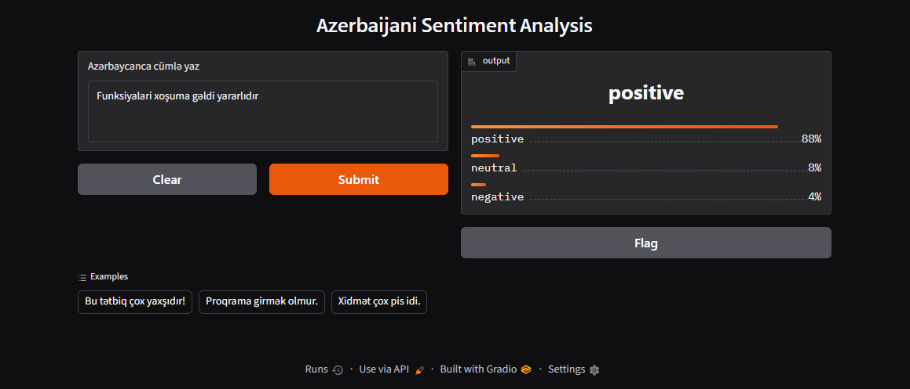
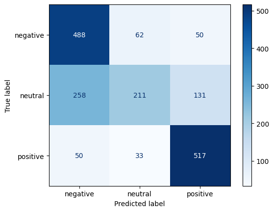

# Azerbaijani Sentiment Analysis

Fine-tuned XLM-RoBERTa for 3-class sentiment analysis (negative / neutral / positive) on Azerbaijani Play Store reviews.

[](https://huggingface.co/twnar/azerbaijani_sentiment_analysis)
[](https://colab.research.google.com/drive/1WJEgo8SpQ7SBp4IDwEN8vYInXHr_RJ4B?usp=sharing)



## Data
[hajili/azerbaijani_review_sentiment_classification](https://huggingface.co/datasets/hajili/azerbaijani_review_sentiment_classification) (MIT), ~160K reviews. Star ratings mapped to labels: 1-2 → negative, 3 → neutral, 4-5 → positive.

The data is heavily imbalanced (~85% positive, ~2% neutral), so I used balanced sampling: up to 5,000 training examples per class and a balanced test set of 600 per class.

## Method
- Base model: `xlm-roberta-base`
- 3 epochs, lr 2e-5, batch size 16, max length 128
- Trained on a free Colab T4 GPU (~13 min)

## Results (balanced test set, 1,800 examples)

| Class | Precision | Recall | F1 |
|---|---|---|---|
| negative | 0.613 | 0.813 | 0.699 |
| neutral | 0.690 | 0.352 | 0.466 |
| positive | 0.741 | 0.862 | 0.797 |

Accuracy: 0.676 | Macro-F1: 0.654



## Error analysis
- Labels come from star ratings and are noisy. Clearly positive reviews like "əla" sometimes carry 1-2 stars, so some "errors" are label errors.
- The neutral class (3 stars) is the hardest (recall 0.35): these reviews are mostly complaints or questions, which the model confuses with negative.

## Usage
```python
from transformers import pipeline

clf = pipeline("text-classification", model="twnarx/azerbaijani_sentiment_analysis")
print(clf("Bu tətbiq çox yaxşıdır!"))
```

## Limitations and future work
- Domain: app reviews only (banking, taxi, telecom, shopping apps).
- Planned: evaluate on a second Azerbaijani sentiment dataset to measure generalization; compare with `bert-base-multilingual-cased`.

## License
MIT
